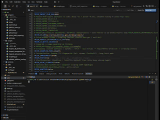
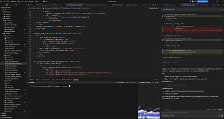
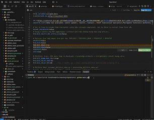
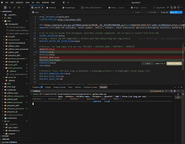
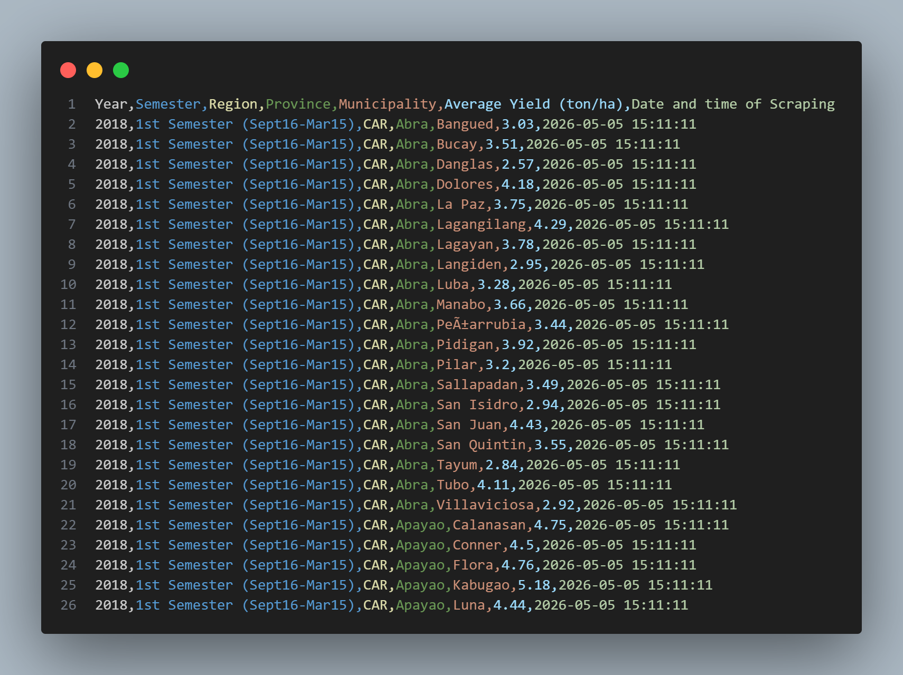

# OpenStatv2 — Agri Data Scraping + CPT Data Curation

OpenStatv2 is an end-to-end pipeline for **collecting Philippine agriculture data** from multiple sources (web pages, PDFs, Excel/CSV exports) and converting them into **CPT (Continued Pre-Training) JSONL corpora**.

This repo contains two major parts:
- **Scraping + processing code** (modular Python package under `src/` + `main.py` runner)
- **Curated deliverables** (final JSONL corpora and audit files stored in a separate `datacuration/` folder)

---

## What this project produces

- **CPT-ready JSONL corpora** (one JSON object per line; consistent schema)
- **Per-document / per-file JSON outputs** (for auditing and inspection)
- **Checkpoints** to resume long scraping sessions without duplication

---

## Supported data sources (current)

- **PhilRice PDFs**: downloads knowledge products and publications (PDF collection)
- **PhilRice News**: scrapes news articles (text extraction)
- **PinoyRice Knowledge Bank**: scrapes selected content pages + downloads PDFs
- **IRRI Philippines News**: scrapes news articles and downloads linked PDFs (with retry/backoff for blocking)
- **OpenSTAT (PSA)**: automates table selections and downloads Excel; includes Cloudflare-aware handling
- **PRiSM (PhilRice)**: dashboard scrape (Scrapling) or full yield table export via HTTP (`PRISM_JOB=export_yield_csv`)

---

## Sample scraper outputs (`output_image/`)

Screenshots and recordings from real runs (for demos and documentation):

| Source | Preview |
|--------|---------|
| PhilRice PDFs |  |
| PhilRice News / demo run |  |
| PinoyRice |  |
| IRRI (Philippines) |  |
| OpenSTAT (PSA) |  |
| PRiSM |  |

JSON/CSV corpus shape examples: `docs/sample_corpus_outputs.jsonc` and `docs/scraper_output_examples.jsonc`.

---

## CPT processing (how we standardize data)

All processed corpora follow the same core record structure:
- **Required**: `text`, `input`, `content`, `source`, `doc_id`
- **Optional**: `url`, `title`, `filename`, `page`, plus dataset-specific metadata (for tabular corpora)

We support three CPT conversion patterns (mirrors the `datacuration` notebooks):

- **Document TXT**: clean → (optional) chunk → write JSONL
- **PDF**: extract per page → remove repeated headers/footers → one record per page (optional sub-chunking) → write JSONL
- **Tabular**: parse table → reshape (wide→long) → clean/filter → convert row/group to natural language → write JSONL

---

## How to run (scraping)

From the project root:

```bash
python main.py
```

Enable/disable sources via `.env` flags:
- `PHILRICE=true|false`
- `PHILRICE_NEWS=true|false`
- `PINOYRICE=true|false`
- `OPENSTAT=true|false`
- `IRRI=true|false`
- `PRISM=true|false` (optional: `PRISM_JOB=export_yield_csv` for yield CSV only)

Notes:
- Runs are designed to be **resumable** using checkpoints.
- Some sources may require a visible browser session (Cloudflare / anti-bot pages).

---

## Where outputs go (during scraping + processing)

- **Raw downloads / scraped text**: saved in project output folders (PDF/text collections)
- **Processed corpora**: exported as JSONL plus per-file JSON outputs
- **Checkpoints**: stored as JSON files to support resume and avoid duplicates

If you need a meeting-ready overview, see: `docs/PROJECT_PRESENTATION.md`.

---

## `datacuration/` (final curated deliverables)

The `datacuration/` folder (kept alongside this project in your workspace) contains the compiled datasets and **final CPT-ready corpora** produced during data curation.

**What’s inside**
- **Final corpora (JSONL)**: includes document corpora plus tabular-to-text corpora
  - e.g., IRRI articles corpus, PhilRice PDFs, PhilRice News, PinoyRice text/PDFs
  - **Stream discharge CPT**: grouped by station + month → narrative paragraphs + monthly stats
  - **Farmgate prices CPT**: each row converted into a factual sentence
- **Per-file audit outputs**: per-document JSON files for inspection/debugging
- **Processing notebooks** (reference implementations):
  - `cpt_processing_pipeline.ipynb` (TXT/PDF → CPT JSONL)
  - `cpt_stream_discharge.ipynb` (stream discharge → monthly narrative CPT)
  - `cpt_tabular_farmgate.ipynb` (farmgate tabular → sentence CPT)

If you plan to share the curated outputs, point stakeholders to the `datacuration/corpus/` JSONL files (these are the training-ready deliverables).

---

## Documentation

- `docs/` contains project notes, specs, and the presentation markdown.

---

## Docker (optional)

If you use containers, see `docker-compose.yml` in the project root.
