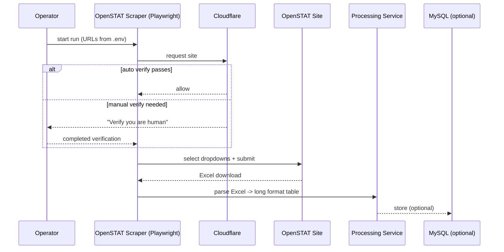

# OpenStatv2 — Project Presentation (Slide-ready Markdown)

> Audience: mixed technical + stakeholders  
> Purpose: explain the end-to-end data pipeline (scrape → process → corpus outputs) and the internal structure (without code paths).

---

## Slide 1 — Title
### OpenStatv2: Agriculture Data Scraping + Corpus Processing Pipeline

**One-liner**
- A modular pipeline that **collects** agri data from multiple sources (web pages, PDFs, Excel) and **standardizes** them into a unified, CPT-ready dataset (JSONL).

**Core outputs**
- Source-specific corpora (JSONL files)
- Resumable scraping via checkpoints (so long runs can continue safely)

---

## Slide 2 — Problem & Motivation
**Challenges**
- Data is distributed across multiple sites and formats (HTML articles, PDF documents, Excel exports).
- Manual copy/paste is slow, inconsistent, and hard to reproduce.
- For downstream analytics / NLP / RAG / training, we need **consistent schema + clean text**.

**What we built**
- A repeatable pipeline with:
  - web scraping + downloading
  - checkpoint/resume
  - cleaning + chunking
  - standardized exports

---

## Slide 3 — High-level Architecture (Internal Components)
**Component layout**
- **Configuration**: one place to control where outputs are written (keeps runs consistent)
- **Scrapers (Acquisition)**: browser automation that collects text/PDFs/Excel exports from source websites
- **Services (Processing)**: cleaning + chunking + exporting standardized JSON/JSONL datasets
- **Shared corpus utilities**: common chunking rules, PDF extraction/cleanup, and standardized record format
- **Infrastructure helpers**: internet checks, anti-blocking/bypass utilities, optional database integration

**Design principle**
- Separation of concerns: **Scrape** ≠ **Process**. Shared logic lives in `agri_corpus/`.

---

## Slide 4 — Data Flow (End-to-End)
**Pipeline**
1. Scrapers collect text and/or PDFs (and OpenSTAT Excel exports)
2. Outputs are stored in a structured project folder and progress is tracked in checkpoints
3. Services clean + chunk + export a consistent corpus format

---

## Slide 4b — CPT Processing (How raw data becomes training data)
**Main idea**
- We transform raw documents/tables into **natural language training records** (JSONL).
- Output is optimized for ML training: consistent schema, clean text, and traceable `doc_id`.

**We handle 3 input types**
- **Document text** (from web articles or `.txt`)
- **PDF documents** (multi-page text + optional tables)
- **Tabular datasets** (Excel/CSV; converted into sentences/paragraphs)

---

## Slide 5 — Standard Output Format (CPT-ready JSONL)
All corpora use a common record schema:

**Required**
- `text`, `input`, `content`: cleaned chunk text (duplicated for downstream compatibility)
- `source`: dataset tag (e.g., PhilRice, PinoyRice, IRRI, OpenSTAT)
- `doc_id`: stable identifier for traceability

**Optional metadata**
- `url`, `title`, `filename`, `page`

**Why it matters**
- You can merge multiple sources into one pipeline without schema conflicts.

---

## Slide 5b — CPT Data Flow (Document TXT / PDF)
**TXT documents**
- Parse optional header fields (URL, Title) if present
- Clean the body using a ruleset (remove footer blocks, leading “SHARE/date/title” noise if needed)
- Optional chunking (paragraph-aware) to keep records at a manageable size
- Write JSONL (one record per chunk)

**PDF documents**
- Extract text per page (and tables if available)
- Detect repeated headers/footers across pages (frequency-based) and remove them
- Default output is **one record per page**, with optional sub-chunking for long pages
- Write JSONL (one record per page/chunk)

---

## Slide 6 — Sources Covered (Scrapers)
**Implemented scrapers**
- **PhilRice PDFs**: crawls publication pages + pagination → downloads PDFs
- **PhilRice News**: extracts article text to one text file per article
- **PinoyRice**: scrapes content pages for text + collects PDFs from download sections (pagination-aware)
- **IRRI Philippines**: scrapes IRRI news articles + collects/downloads PDFs with retry/backoff on blocking (e.g., 403)
- **OpenSTAT (PSA)**: automates selections + downloads Excel; Cloudflare-aware flow

---

## Slide 7 — Processing Pipelines (Services)
**Implemented services**
- **PhilRice PDF → CPT**
  - input: downloaded PDFs
  - output: per-document JSON + combined corpus JSONL
- **PhilRice News text → CPT**
  - input: scraped article text files
  - output: per-article JSON + combined corpus JSONL
- **PinoyRice (text + PDF) → CPT**
  - output: chunked text corpus + PDF corpus + per-file outputs
- **IRRI text → CPT**
  - input: scraped IRRI article text files
  - output: combined corpus JSONL + per-file JSON
- **OpenSTAT Excel → Clean table**
  - converts Excel exports to a clean long-format table
  - includes automated downloads + manual-download fallback

---

## Slide 8 — Reliability & “Production-style” Features
**Resumable runs**
- Every scraper uses checkpoints to skip completed items and resume safely.

**Anti-blocking strategy**
- configurable delays
- retries/backoff (especially for IRRI 403 and OpenSTAT Cloudflare)
- optional stealth tooling

**Quality controls**
- PDF noise detection: removes repeated headers/footers across pages
- cleaning rules for text sources before chunking

---

## Slide 9 — What We Will Present (Meeting Narrative)
**Suggested storyline (5–10 minutes)**
- **Problem**: multi-format agri data is scattered; manual collection is not reproducible
- **Solution**: OpenStatv2 unified pipeline (scrape → process → standardized corpus)
- **Architecture**: show the component diagram + the data flow diagram
- **Deliverables**: demonstrate the JSONL corpus outputs and how they can feed analytics/AI
- **Reliability**: checkpoints + retry strategies

---

## Slide 10 — Demo Plan (Low-risk)
**Option A (fastest): show outputs**
- show one combined corpus (JSONL) and one per-document/per-article JSON

**Option B: run one processing step**
- run a service (e.g., IRRI TXT → CPT) to show repeatability and clean outputs

**Option C: checkpoint/resume**
- show a checkpoint file and explain “skip already scraped” behavior

---

## Slide 11 — Process Flow Diagram (Copy to slides)
> If your slide tool doesn’t render Mermaid, you can:
> - paste into any Mermaid renderer and export PNG/SVG
> - or take a screenshot from a Markdown preview that supports Mermaid

```mermaid
flowchart LR
  A[Scrapers<br/>Playwright] --> B[Raw outputs<br/>(text / PDFs / Excel)]
  A --> C[Checkpoints<br/>(resume state)]
  B --> D[Services<br/>clean + chunk]
  D --> E[Per-file outputs<br/>(JSON)]
  D --> F[Combined corpus<br/>(JSONL)]
  F --> G[Downstream use<br/>RAG / embeddings / training / analytics]

  subgraph Sources
    S1[PhilRice PDFs]
    S2[PhilRice News]
    S3[PinoyRice]
    S4[IRRI PH]
    S5[OpenSTAT PSA]
  end

  Sources --> A
```

---

## Slide 11b — CPT Processing Flow (From raw → CPT JSONL)
```mermaid
flowchart TB
  subgraph Inputs
    T[Text documents<br/>articles / .txt]
    P[PDF documents<br/>multi-page]
    X[Tabular datasets<br/>Excel / CSV]
  end

  subgraph TXT[TXT pipeline]
    T1[Parse URL/Title (optional)]
    T2[Clean & normalize text]
    T3[Optional chunking<br/>paragraph-aware]
    T4[Create CPT records<br/>one per chunk]
  end

  subgraph PDF[PDF pipeline]
    P1[Extract per page]
    P2[Detect repeated headers/footers]
    P3[Clean per page]
    P4[One record per page<br/>(optional sub-chunk)]
  end

  subgraph TAB[Tabular pipeline]
    X1[Parse + standardize columns]
    X2[Wide -> long (tidy)]
    X3[Clean/filter (remove summaries)]
    X4[Row/group -> natural language]
    X5[Create CPT records]
  end

  Outputs[CPT JSONL dataset<br/>consistent schema]

  T --> T1 --> T2 --> T3 --> T4 --> Outputs
  P --> P1 --> P2 --> P3 --> P4 --> Outputs
  X --> X1 --> X2 --> X3 --> X4 --> X5 --> Outputs
```

---

## Slide 12 — Component Architecture Diagram (Modules & Responsibilities)
```mermaid
flowchart TB
  config[Configuration<br/>consistent output locations]

  subgraph scrapers[Scrapers (Acquisition)]
    sp[PhilRice PDFs<br/>PDF downloader]
    sn[PhilRice News<br/>article text extraction]
    sr[PinoyRice<br/>text + PDF harvesting]
    si[IRRI Philippines<br/>news + PDFs]
    so[OpenSTAT PSA<br/>Excel downloads]
  end

  subgraph services[Services (Processing)]
    vp[PhilRice PDFs<br/>PDF -> corpus JSONL]
    vn[PhilRice News<br/>text -> corpus JSONL]
    vr[PinoyRice<br/>text + PDF -> corpora]
    vi[IRRI<br/>text -> corpus JSONL]
    vo[OpenSTAT<br/>Excel -> clean table]
  end

  subgraph corpus[Shared Corpus Utilities]
    cu[Standard record schema]
    tu[Chunking + safe IDs]
    pu[PDF extract + cleanup]
    su[URL + checkpoint helpers]
  end

  subgraph utils[Infrastructure Helpers]
    uu[Network guards]
    ub[Anti-blocking / bypass tools]
    ud[Database integration (optional)]
  end

  config --> scrapers
  config --> services

  corpus --> scrapers
  corpus --> services

  utils --> scrapers
  utils --> services

  scrapers --> data[(Raw artifacts<br/>text / PDFs / Excel)]
  services --> out[(Processed outputs<br/>JSON / JSONL)]
```

---

## Slide 13 — Stream Flow / Discharge → CPT (Monthly Narrative Records)
**What it is**
- Daily stream discharge (Q) measurements per gauge station (unit: typically \(m^3/s\)).

**Why we don’t do 1 record per day**
- Too many short/empty sentences; low information density.
- Instead: **group by Station + Year + Month** to produce a rich paragraph that captures:
  - what stream discharge means (static factual definition)
  - coverage (days with recorded values vs missing days)
  - day-by-day values (for recorded days)
  - monthly statistics (min/max/mean)

**Example output style (one record)**
- “In January 2005, station AR.001 recorded daily stream discharge… Discharge was recorded on 3 out of 31 days… Monthly statistics…”

---

## Slide 13 — OpenSTAT Flow (Excel → Table → Storage)


---

## Slide 13b — Farmgate Prices (Tabular) → CPT (One Row → One Sentence)
**Approach**
- Convert structured price tables into natural language so the model learns factual relationships:
  - time (Month/Year) + location + commodity + price.

**Transformation**
- Wide Excel with multi-row headers → long/tidy table (one row per geo/commodity/month)
- Remove “Annual” summary rows (we keep monthly observations)
- For missing prices: still produce a sentence (“had no recorded data”) to preserve coverage knowledge

**Example sentence**
- “In August 2023, the farmgate price of Corngrain (Maize) White, matured in Abra was ₱61.63 per kilogram.”

---

## Slide 14 — Closing & Next Steps
**Summary**
- OpenStatv2 is a modular system that turns raw multi-format agri sources into a standardized corpus.
- It is designed for reproducibility: checkpoints, consistent paths, and shared utilities.

**Next steps (optional roadmap)**
- Add validation scripts (JSONL schema checks, quality thresholds)
- Add run summaries (counts, skipped reasons, runtime)
- Improve observability (central logs, metrics)

